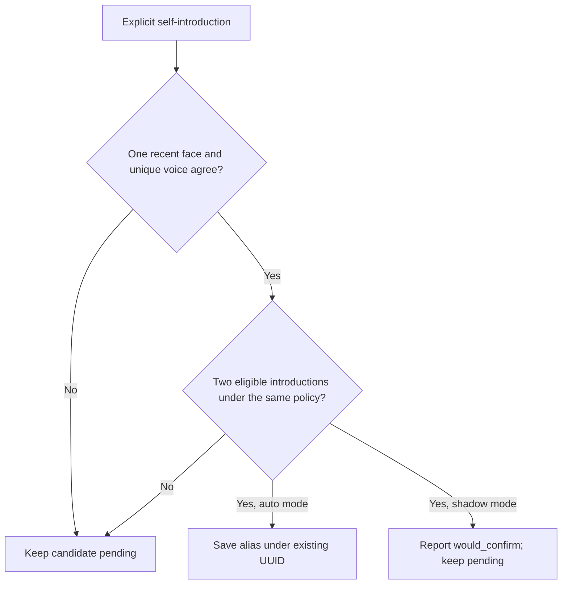

# Face and voice agreement: test first, then fix

The original issue is an already-known person getting a second UUID after using another name.
The earlier identity-first fix is documented in [identity-registration-testing.md](identity-registration-testing.md).
This follow-up tightens when a new name may become a confirmed alias of that UUID.

On November 3, 2026, we added the expected outcomes below and ran them **before changing the
implementation**, against fork commit `0dcd4049319a3cc7f79865c850a1931f5a3718d7`. This is a deliberate
tightening of the earlier voice-only alias policy, not evidence that the face model itself is broken.

## Before and after

Each agreement case has two explicit introductions with a strong, unique saved-voice match.
The expected outcome is pending in both auto and shadow modes when the face evidence is insufficient.

| Case | Before fix (auto) | After fix (auto) |
| --- | --- | --- |
| No visible face | Incorrectly confirmed | Pending |
| Only an unknown face | Incorrectly confirmed | Pending |
| Known face plus unknown bystander | Incorrectly confirmed | Pending |
| Two face tracks carrying the same UUID | Incorrectly confirmed | Pending |
| Face score below threshold | Incorrectly confirmed | Pending |
| Face score exactly at threshold | Incorrectly confirmed | Pending |
| Missing face score | Incorrectly confirmed | Pending |
| Null face score | Incorrectly confirmed | Pending |
| Face frame two seconds from speech start | Incorrectly confirmed | Pending |
| One introduction without a face, then one valid introduction | Incorrectly confirmed | Pending |

All 10 new agreement tests failed before the fix and pass afterward. A separate database regression
also failed first: one old-policy vote plus one new-policy vote confirmed the alias. It now takes two
eligible votes from the same policy. Old evidence remains available for inspection.

The valid path still works: two explicit introductions, each with one recent face matching the
verified voice, confirm the alias in auto mode under the **existing UUID**. Canonical names and
biometric profiles remain unchanged. Shadow mode reports `would_confirm` and keeps lookup unchanged.



## Run the checks

Use the Python 3.11 virtual environment from the repository root. These tests use temporary databases
and fake model/LLM results; no camera, external API, or live identity database is involved.

```powershell
$env:PYTHONPATH = '.'
$env:PYTHONIOENCODING = 'utf-8'
.\.venv\Scripts\python.exe tests/test_worker_helpers.py
.\.venv\Scripts\python.exe tests/test_database.py
.\.venv\Scripts\python.exe tests/test_api_worker_queue.py
.\.venv\Scripts\python.exe -m scripts.replay_name_learning --cases tests/fixtures/name_learning_agreement.json --mode auto
```

The three offline suites passed. The helper suite includes all 26 replay scenarios in both modes
(52 scenario runs), including valid aliases, shared names, disagreements, duplicate events, misleading
name mentions, and the 10 new regressions. The queue test passed outside the restricted Windows
sandbox after its sandbox attempt stalled and was stopped.

[Machine-readable results](name-learning-test-results.json) contain baseline decisions, after-fix
decisions, and fixture hashes. To reproduce the red result without changing your working branch,
create a detached worktree at the baseline commit above, copy the current replay script, two fixture
files, and worker/database test files into that worktree, and run them with the existing venv and
`PYTHONPATH` set to that worktree. The regression tests are expected to fail there.

## What this does not prove

These are control-flow tests, not an accuracy score. Requiring both signals lowers automation
coverage, and two repeated recognition errors can still agree. Face scores use the existing 0.5
threshold; voice thresholds and the two-introduction rule remain uncalibrated. A visible face is
not proof of the active speaker. Vision can reuse cached recognition results, and its cache timestamp
is coordinator receipt time. Real, separately recorded and labeled encounters are still needed.

Default mode remains `shadow`. Existing confirmed aliases are preserved on upgrade and should be
reviewed separately if the older automatic mode was used. New-person enrollment still follows the
earlier registration flow; this follow-up governs alias confirmation for existing people.
